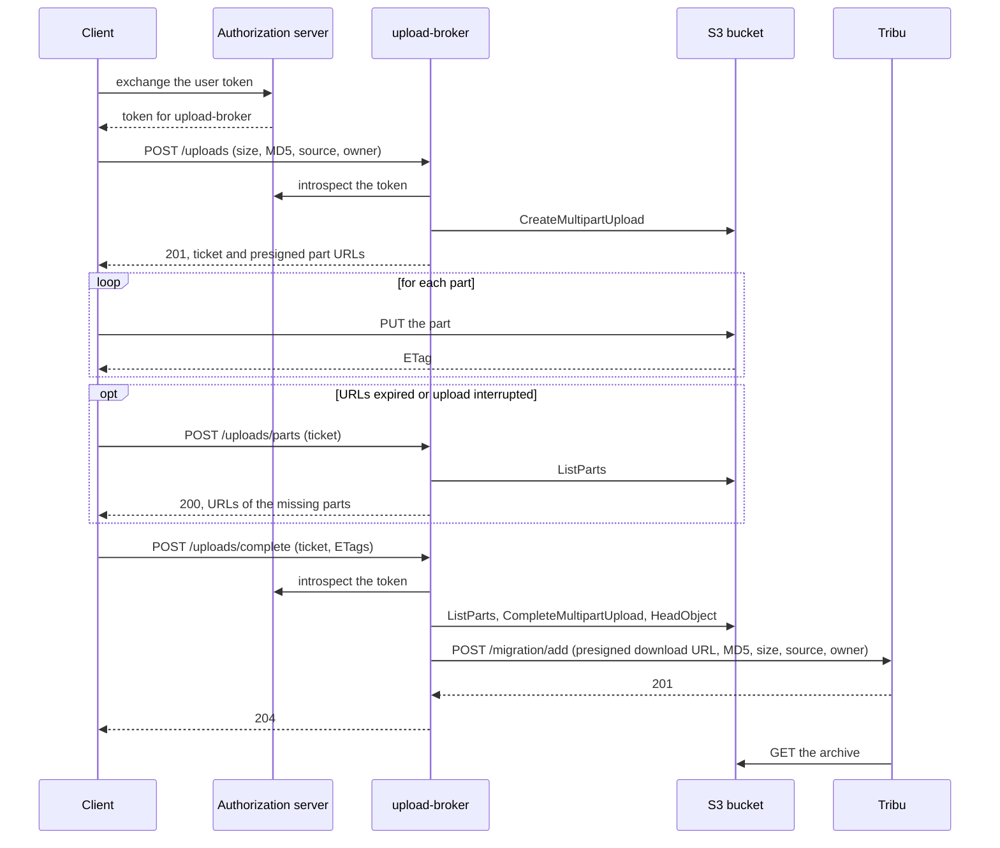

# upload-broker

upload-broker lets authenticated clients upload large files to an S3 bucket without holding any S3 credentials.

It applies the [Valet Key pattern](https://learn.microsoft.com/en-us/azure/architecture/patterns/valet-key):

- the client authenticates with an OAuth 2.0 access token;
- upload-broker starts a multipart upload and returns one presigned URL per part;
- the client uploads the parts straight to the bucket, so files never go through upload-broker;
- the client reports the end of the upload, and upload-broker completes it and notifies the recipient service.

It was written to move workspace archives from [drive-migrator](https://github.com/suitenumerique/drive-migrator) to their destination.

## API



Every route but `/health` requires a bearer token.
Its audience must contain `UPLOAD_BROKER_AUDIENCE`, and its scope must contain `UPLOAD_BROKER_REQUIRED_SCOPE`.
The interactive documentation is served at `/docs`.

| Route | Body | Response |
|---|---|---|
| `POST /uploads` | `source_id`, `size`, `md5`, `title`, `owner` (`email`, `first_name`, `last_name`) | `201` with a `ticket`, the `part_size`, the `expires_at` date and one presigned URL per part |
| `POST /uploads/parts` | `ticket` | `200` with new URLs for the parts the bucket has not received yet |
| `POST /uploads/complete` | `ticket`, `parts` (`number` and `etag` of every part) | `204` once the file is assembled and handed over to Tribu |

The client sends each part with a `PUT` on its URL, and keeps the `ETag` header of the response.
On completion, upload-broker adds the file to the migration queue of Tribu.
Tribu gets a presigned download URL, valid for `UPLOAD_BROKER_PRESIGN_EXPIRATION` after the completion.
When Tribu is unavailable, the client can complete the upload again later.
When Tribu already has a migration for this source, completing the upload answers `409` with `already_queued`.
This happens when the client completes the same upload twice, or when it sends another archive of the same source.

Error responses have a stable code in `detail`:

| Status | Code | Meaning |
|---|---|---|
| `400` | `invalid_ticket` | The ticket is malformed, forged or expired. |
| `403` | `ticket_owner_mismatch` | The ticket was issued to another user. |
| `404` | `upload_not_found` | The upload was purged or never existed. |
| `409` | `parts_mismatch` | The parts differ from the ones the bucket received. |
| `409` | `size_mismatch` | The assembled file does not have the announced size. |
| `409` | `already_queued` | Tribu already has a migration in progress for this source. |
| `413` | `file_too_large` | The file needs more parts than the bucket accepts. |
| `502` | `tribu_rejected` | Tribu refused the file. The reason is in the logs. Retrying will not help. |
| `503` | `tribu_unavailable` | Tribu cannot be reached. Complete the upload again later. |

## Run the container

```console
$ docker run --publish 8080:8080 ghcr.io/yaal-coop/upload-broker
```

The image serves the application with [Granian](https://github.com/emmett-framework/granian) on port 8080.

## Configuration

Settings are read from environment variables:

| Variable | Default | Description |
|---|---|---|
| `UPLOAD_BROKER_S3_ENDPOINT_URL` | required | Public endpoint of the S3 server. The presigned URLs point to it. |
| `UPLOAD_BROKER_S3_REGION` | required | Region of the bucket, for example `fr-par`. |
| `UPLOAD_BROKER_S3_BUCKET` | required | Bucket that receives the files. |
| `UPLOAD_BROKER_S3_ACCESS_KEY_ID` | required | S3 access key. |
| `UPLOAD_BROKER_S3_SECRET_ACCESS_KEY` | required | S3 secret key. |
| `UPLOAD_BROKER_S3_ADDRESSING_STYLE` | `path` | `path` or `virtual`. |
| `UPLOAD_BROKER_OBJECT_PREFIX` | | Prefix of the object keys. |
| `UPLOAD_BROKER_PRESIGN_EXPIRATION` | 7 days | Lifetime of the tickets and of the presigned URLs, in seconds or as an ISO 8601 duration. S3 caps it at 7 days. |
| `UPLOAD_BROKER_PART_SIZE_MIN` | 64 MiB | Minimum part size, in bytes. |
| `UPLOAD_BROKER_MAX_PARTS` | `1000` | Maximum number of parts of an upload: 1000 on Scaleway, 10000 on AWS. |
| `UPLOAD_BROKER_TICKET_KEY` | required | Secret of at least 32 characters that signs the upload tickets. |
| `UPLOAD_BROKER_INTROSPECTION_URL` | required | Token introspection endpoint of the authorization server (RFC 7662). |
| `UPLOAD_BROKER_CLIENT_ID` | required | Client ID of the service at the authorization server. |
| `UPLOAD_BROKER_CLIENT_SECRET` | required | Client secret of the service at the authorization server. |
| `UPLOAD_BROKER_AUDIENCE` | required | Audience that the tokens must contain. |
| `UPLOAD_BROKER_REQUIRED_SCOPE` | required | Scope that the tokens must contain. |
| `UPLOAD_BROKER_INTROSPECTION_TIMEOUT` | `10` | Timeout of the introspection requests, in seconds. |
| `UPLOAD_BROKER_TRIBU_URL` | required | Base URL of the Tribu API. |
| `UPLOAD_BROKER_TRIBU_SECRET_KEY` | required | Secret key sent to the Tribu migration API. |
| `UPLOAD_BROKER_TRIBU_TIMEOUT` | `10` | Timeout of the requests to Tribu, in seconds. |
| `UPLOAD_BROKER_TRUSTED_PROXIES` | `127.0.0.1` | Reverse proxies whose `X-Forwarded-*` headers are trusted: comma-separated addresses or networks, or `*` for all. |

## Development

The project uses [uv](https://docs.astral.sh/uv/).

```console
$ uv run pytest
$ uv run prek run --all-files
```

### Local stack

`compose.yaml` starts upload-broker and the services it needs:

```console
$ docker compose up --wait
```

Stop it with `docker compose down`. Add `--volumes` to also delete the Garage data.

| Service | Address on the host | Role |
|---|---|---|
| `upload-broker` | `http://127.0.0.1:8090` | The broker. It reloads when `src/` changes. |
| `garage` | `http://garage.localhost:3900` | Single-node [Garage](https://garagehq.deuxfleurs.fr/) S3 server. Its admin API is on `http://127.0.0.1:3903`. |
| `garage-init` | | Creates the bucket and the key, then stops. |
| `mock-tribu` | `http://127.0.0.1:8081` | Fake Tribu migration API. It reloads when `dev/tribu/` changes. |
| `menshen` | `http://127.0.0.1:8072` | [menshen](https://github.com/suitenumerique/menshen) token exchange server. upload-broker checks its tokens there. |
| `menshen-init` | | Creates the menshen services and exchange rule, then stops. |
| `menshen-postgres`, `menshen-redis` | | Storage for menshen. |

The S3 endpoint is `http://garage.localhost:3900`, in the `garage` region, with the `uploads` bucket.
Its access key is `GK000000000000000000000000` and its secret key is 64 zeros.
Presigned URLs point to `garage.localhost`, so they work in the containers and on the host.
In the containers, curl does not use DNS for `*.localhost` and cannot reach Garage. Python and wget can.
Browsers and most Linux systems resolve `*.localhost` to the loopback address.
If yours does not, add `127.0.0.1 garage.localhost` to `/etc/hosts`.

menshen exchanges the Keycloak tokens of drive-migrator for upload-broker tokens.
The `drive-migrator` client asks for the `upload-broker` audience and the `depot:archive:create` scope.
The Keycloak token must have the `openid` scope.
menshen exchanges tokens on `POST /auth/token/exchange/`, and upload-broker checks them on `POST /auth/token/introspect/`.
The client secrets are in `dev/menshen/menshen_init.py`.
menshen reaches Keycloak only on the drive-migrator network.
Without drive-migrator, menshen starts, but it cannot exchange tokens.

### Fake Tribu

`mock-tribu` answers `POST /migration/add` like Tribu.
It checks the secret key, the fields and the file size, then downloads the file in the background and checks its MD5.
It refuses a source it already knows with `409`, whatever its status, until `DELETE /migrations` clears it.

| Route | Effect |
|---|---|
| `GET /migrations` | Lists the received archives with their status: `queued`, `downloaded`, `checksum_mismatch` or `download_failed`. |
| `DELETE /migrations` | Forgets the received archives. |
| `POST /failures` | Queues a status for the next `POST /migration/add`. |
| `DELETE /failures` | Empties the queue. |

For example, to make Tribu answer `503` once:

```console
$ curl -X POST http://127.0.0.1:8081/failures -H 'Content-Type: application/json' -d '{"status": 503}'
```

To make Tribu unreachable, stop it with `docker compose stop mock-tribu`.
The fake Tribu keeps its state in memory. It loses it when it reloads or restarts.

### With drive-migrator

`compose.drive-migrator.yaml` connects the stack to the network of the drive-migrator development stack.
Start drive-migrator first, then:

```console
$ docker compose -f compose.yaml -f compose.drive-migrator.yaml up --wait
```

From the drive-migrator containers, the broker is `http://upload-broker:8080`, menshen is `http://menshen:8000`, the fake Tribu is `http://mock-tribu:8081` and Garage is `http://garage.localhost:3900`.
Stop upload-broker with `docker compose down` before drive-migrator, or Docker cannot remove the drive-migrator network.

#### Simulate a migration in a browser

drive-migrator needs a version with the Tribu destination.
For now, it is on the `feat/tribu-destination` branch.
Its `env.d/development/common` must have:

- `SOURCE_BACKEND=core.sources.filesystem.FileSystemSourceBackend`;
- `core.destinations.tribu.backend.TribuDestinationBackend` in `DESTINATION_BACKENDS`;
- `UPLOAD_BROKER_URL=http://upload-broker:8080`, `UPLOAD_BROKER_AUDIENCE=upload-broker` and `UPLOAD_BROKER_SCOPE=depot:archive:create`;
- `MENSHEN_SERVER_ROOT_URL=http://menshen:8000`, `MENSHEN_CLIENT_ID=drive-migrator`, and `MENSHEN_CLIENT_SECRET` from `dev/menshen/menshen_init.py`.

On a new database, add the `read-only-mode` feature flag as inactive on `http://localhost:8071/admin/core/featureflag/add/`.
The admin needs a superuser: run `make superuser` in the drive-migrator repository.
Without it, drive-migrator runs in read-only mode and does not list the workspaces.

Start the drive-migrator front end. Run this in the drive-migrator repository, not in this one:

```console
$ docker compose up -d frontend-dev
```

Then:

1. Open `http://localhost:3000`, pick « Tribu » in « Vers », and click « Démarrer la migration ».
2. Sign in as `impress`, with the password `impress`.
3. The next page asks for a Resana connection, which the filesystem source does not need.
   Skip it and open `http://localhost:3000/dashboard` in the same tab.
   The tab keeps the target you picked. A new tab sends the workspaces to LaSuite Fichiers.
4. Check that the page says « Chaque escape sélectionné sera envoyé à Tribu ».
   Select a workspace, click « Migrer », then « Démarrer la migration ».
   The workspaces are the folders of `data/demo-data/impress@impress.world/` in drive-migrator.
5. The fake Tribu receives the archive, then downloads it:

   ```console
   $ curl http://127.0.0.1:8081/migrations
   ```

   The status goes from `queued` to `downloaded`.

The Keycloak session of drive-migrator expires after 30 minutes without activity.
After that, menshen refuses the exchange and the migration fails.
Sign out and in again before you start a migration.

A migrated workspace cannot be migrated again.
To start over, reset the workspaces. Run this in the drive-migrator repository, not in this one:

```console
$ docker compose exec app-dev uv run python manage.py set_workspaces_status_none
```

Then empty the fake Tribu, from any directory:

```console
$ curl -X DELETE http://127.0.0.1:8081/migrations
```

### Garage tests

The unit tests simulate S3 with [moto](https://github.com/getmoto/moto), which does not check signatures or expiration dates.
The tests of the presigned URLs run against Garage on `http://127.0.0.1:3900`, and are not part of the default test run:

```console
$ docker compose up --detach --wait garage
$ uv run dev/garage/garage_init.py
$ uv run pytest tests/garage
```
